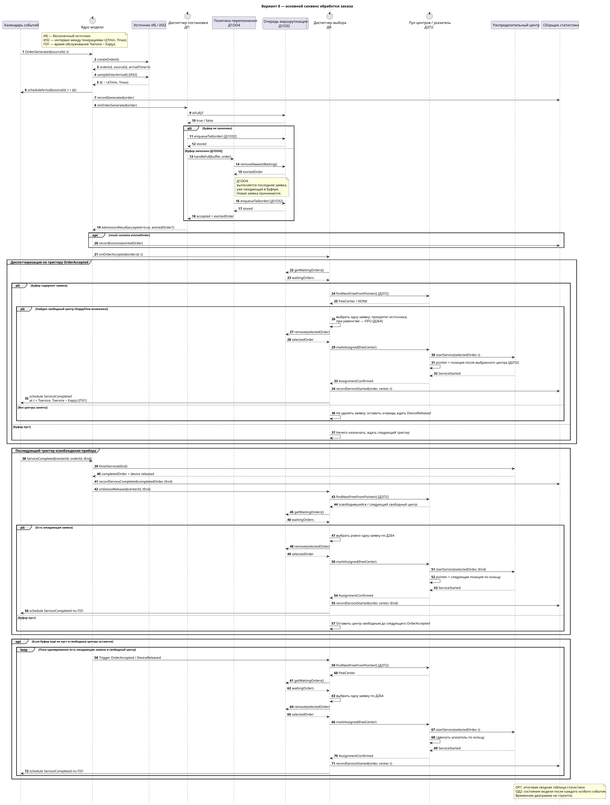
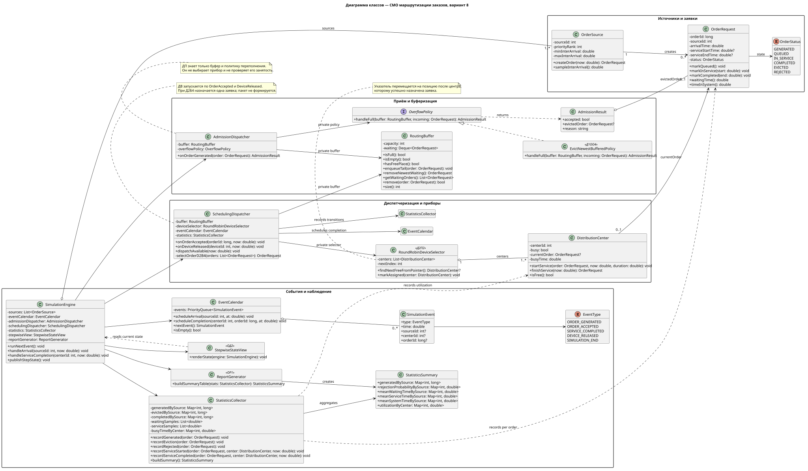
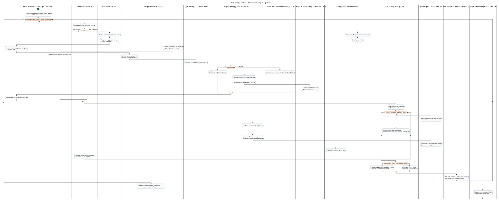

# API маркетплейса для маршрутизации заказов — вариант 8

**Марьянков Леонид Евгеньевич · группа 5130904/40102**

Первичные артефакты курсовой работы по имитационному моделированию СМО. API принимает заказы покупателей из веб- и мобильного приложения, помещает их в общую ограниченную очередь и назначает доступным распределительным центрам для комплектации и отправки.

## Формула варианта

`ИБ | ИЗ2 | ПЗ1 | Д1ОЗ2 | Д1ОО4 | Д2П2 | Д2Б4 | ОР1 | ОД2`

| Код | Правило в модели |
| --- | --- |
| ИБ | Бесконечный источник: генерация продолжается независимо от обслуживания предыдущих заказов. |
| ИЗ2 | Интервал между генерациями равномерно распределён на заданном диапазоне `U(Tmin, Tmax)`. |
| ПЗ1 | Время обслуживания распределительного центра имеет экспоненциальное распределение: `Tservice ~ Exp(μ)`. |
| Д1ОЗ2 | Общая очередь: заказ добавляется в хвост; после удаления элемента оставшиеся заявки сдвигаются к началу. |
| Д1ОО4 | При заполненном буфере последняя ожидающая заявка вытесняется, а новая занимает освободившееся место. |
| Д2П2 | Свободный центр выбирается по кольцу, начиная с текущего указателя. После назначения указатель сдвигается на позицию после выбранного центра. |
| Д2Б4 | За раз выбирается одна заявка источника с наивысшим приоритетом. При равном приоритете используется FIFO как детерминированное правило разрешения ничьей. |
| ОР1 | После моделирования формируется сводная таблица статистики. |
| ОД2 | Пошагово отображаются формализованная схема и текущее состояние системы. |

## Бизнес-домен и маппинг

| Элемент СМО | Элемент API маркетплейса |
| --- | --- |
| Источник | Покупатель или класс покупателей, формирующий заказы через веб- или мобильное приложение |
| Заявка | Заказ покупателя с идентификатором, источником и временными отметками |
| Буфер | Общая ограниченная очередь маршрутизации API-шлюза |
| Прибор | Распределительный центр / склад-исполнитель |
| Диспетчер постановки | Модуль приёма заказа и управления буфером |
| Диспетчер выбора | Планировщик назначения заказов на свободные центры |
| Обслуживание | Комплектация и отправка заказа |
| Отказ | Вытесненная последняя заявка при полном буфере |

Подробное описание: [бизнес-домен](docs/business-domain.md), [маппинг](docs/mapping.md), [правила модели](docs/model-rules.md).

## Правила, общие для всех диаграмм

Диспетчер постановки работает с буфером и не проверяет занятость центров. После успешной постановки формируется событие `OrderAccepted`. Диспетчер выбора срабатывает по `OrderAccepted` или по освобождению центра (`DeviceReleased`). Перед извлечением заявки проверяется наличие свободного прибора: если все центры заняты, очередь сохраняется до следующего события освобождения.

Вытесненная при переполнении заявка учитывается как отказ; новая заявка принимается. Сбор статистики учитывает каждую сгенерированную заявку, время ожидания, обслуживания и пребывания в системе, а также занятость каждого центра.

Вариант использует выбор одной заявки по приоритету источника (`Д2Б4`), поэтому пакетная обработка не входит в основной алгоритм. Подробности, включая триггеры и статистику, находятся в [правилах модели](docs/model-rules.md).

## Первичные артефакты

### 1. Общая диаграмма последовательности

Генерация, постановка в буфер, обработка переполнения, занятость центров, выбор одной заявки после освобождения центра и завершение обслуживания.

[PlantUML](docs/diagrams/sequence-main.puml) · [SVG](docs/diagrams/sequence-main.svg) · [PNG](docs/diagrams/sequence-main.png)

### 2. Диаграмма классов

Поля, методы, инкапсуляция и ссылки на компоненты, через которые происходит взаимодействие.

[PlantUML](docs/diagrams/class-diagram.puml) · [SVG](docs/diagrams/class-diagram.svg) · [PNG](docs/diagrams/class-diagram.png)

### 3. Блок-схема с дорожками

Показывает источники событий, постановку в очередь, переполнение, диспетчеризацию, обслуживание, статистику и все основные альтернативы.

[PlantUML](docs/diagrams/flowchart-swimlanes.puml) · [SVG](docs/diagrams/flowchart-swimlanes.svg) · [PNG](docs/diagrams/flowchart-swimlanes.png)

### 4. Отдельные сценарии последовательности

| Сценарий | SVG | PNG | Исходник |
| --- | --- | --- | --- |
| Happy flow: очередь и центр доступны | [SVG](docs/diagrams/sequence-happy-flow.svg) | [PNG](docs/diagrams/sequence-happy-flow.png) | [PlantUML](docs/diagrams/sequence-happy-flow.puml) |
| Переполнение очереди | [SVG](docs/diagrams/sequence-overflow-d1oo4.svg) | [PNG](docs/diagrams/sequence-overflow-d1oo4.png) | [PlantUML](docs/diagrams/sequence-overflow-d1oo4.puml) |
| Ожидание, выборка из буфера и назначение | [SVG](docs/diagrams/sequence-buffer-wait-and-dispatch.svg) | [PNG](docs/diagrams/sequence-buffer-wait-and-dispatch.png) | [PlantUML](docs/diagrams/sequence-buffer-wait-and-dispatch.puml) |

Дополнительно: [навигация по диаграммам](docs/diagrams/README.md)